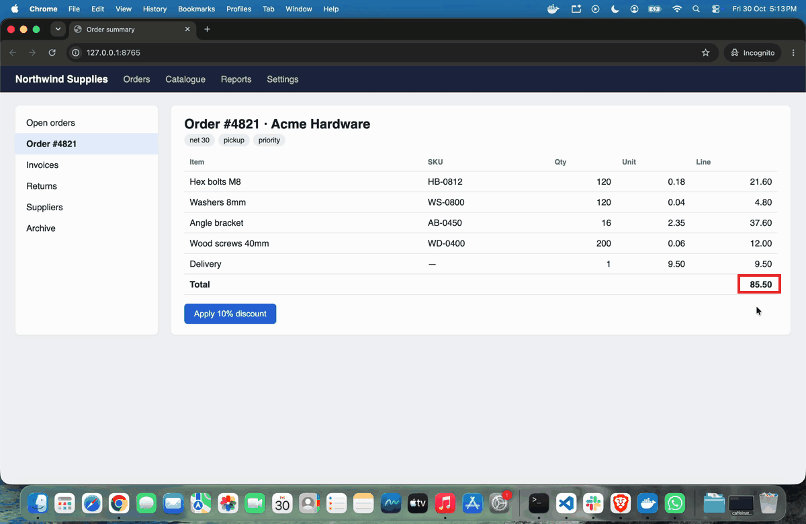
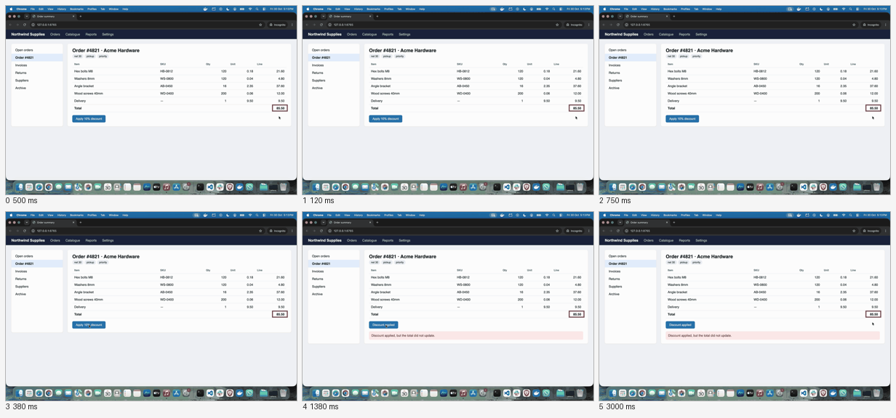

# shotproof

Record a screen interaction on macOS, encode it to a GIF, and prove the GIF meets explicit limits.

Four commands, one Python package, no service, no accounts:

| command | does |
|---|---|
| `shotproof record` | (macOS) drives one scripted pointer move, click or keystroke, parks the pointer, and captures the display to a `.mov` |
| `shotproof encode` | turns a clip into a GIF: fixed decode rate, codec-noise frames merged, a leading still and a trailing hold, an optional stationary marker, and a JSON report beside the output |
| `shotproof frames` | dumps a GIF's frames as PNGs for a look before sharing |
| `shotproof check` | measures a GIF (duration, changed frames, longest still and whether it ends the file, byte and pixel size, full decode) and exits 1 when a limit is exceeded |

`check` is pure Python + Pillow and runs anywhere, CI included. `encode` adds `imageio-ffmpeg` for decoding.
Only `record` is macOS-bound.

## Demo



Made on a laptop display with the commands as published, nothing edited afterwards:

```
$ shotproof record demo.mov --seconds 6 --lead 1.5 --move-to 420,572 --click --park 1380,560 --settle 0.4
$ shotproof encode demo.mov demo.gif --fps 8 --max-width 1200 --end-hold 1.5 --marker 2690,1000,160,70
$ shotproof check demo.gif --min-end-hold 1.5 --max-changes 8
demo.gif: 6 frames, 6.13s, 4 changes, longest still 3.0s, final still 3.0s, 1200x780, 411695 bytes
PASS
```

The encode report is [docs/demo.gif.json](docs/demo.gif.json): 48 frames decoded at 8 fps, 42 merged as noise,
6 kept. `check` counts 4 changes rather than 5 because the second kept frame (the system's recording indicator
finishing its fade-in, 120 ms after the first) lands just under the change threshold once the GIF palette has
flattened it; the count is the same at `--tolerance 8`, `16` and `32`. The four are the indicator appearing,
the pointer arriving on the button, the click's result, and the pointer parking. The last frame holds for
3.0 s because the parked tail already lasted longer than `--end-hold`.

## Status

| command | state |
|---|---|
| `check` | implemented, tested |
| `encode` | implemented, tested end to end on a synthetic H.264 clip |
| `frames` | implemented, tested |
| `record` | implemented; the plan and argument checks are tested, the native path (CoreGraphics events + `screencapture`) is exercised by hand, see *Demo*; `--keys` has not been used in a recorded take yet |

## Install

```
git clone https://github.com/vipul21435/shotproof
cd shotproof
pip install .             # check only
pip install '.[encode]'   # adds imageio-ffmpeg for encode
pip install '.[dev]'      # plus pytest
python -m pytest
```

Python 3.9 or newer.

## Exit codes

| code | meaning |
|---|---|
| 0 | every check passed (or encode/record completed) |
| 1 | a check failed, including a file that does not decode |
| 2 | usage or input error (bad flag value, missing input, unsupported platform, a failed system call) |

## `shotproof check`

```
$ shotproof check sample.gif --min-end-hold 1.5
sample.gif: 3 frames, 2.62s, 1 change, longest still 1.62s, final still 1.62s, 320x200, 1488 bytes
PASS
```

```
$ shotproof check sample.gif --max-changes 0 --json
{
  "ok": false,
  "failures": [
    "1 changed frames exceeds 0"
  ],
  "measurements": {
    "frames": 3,
    "duration_s": 2.62,
    "changed_frames": 1,
    "longest_hold_s": 1.62,
    "end_hold_s": 1.62,
    "hold_at_end": true,
    "bytes": 1488,
    "width": 320,
    "height": 200
  }
}
```

Limits are flags. The defaults are my own idea of a strict reviewer (a short clip, few changes, a few megabytes);
change them with flags or disable them all with `--no-limit`:

| flag | default | checks |
|---|---|---|
| `--max-duration S` | 10 | total play time |
| `--max-changes N` | 32 | frames that visibly differ from the previous one |
| `--min-end-hold S` | off | the file must end on a still at least this long |
| `--max-hold S` | off | no still run anywhere may exceed this |
| `--max-bytes B` | 3500000 | file size |
| `--max-width PX`, `--max-height PX` | off | pixel size |

Every frame is decoded regardless; a truncated or corrupt file fails with `decode: ...`.

Several files can be checked at once (`shotproof check a.gif b.gif`); the exit code is 1 if any fails, and
`--report results.json` writes every file's measurements and failures for CI to keep.

`--tolerance` (default 8 levels) and `--min-fraction` (default 0.0005) tune what counts as a change, and
`--ignore X,Y,W,H` (repeatable, GIF pixels) leaves a region such as a clock out of it; *How the checks work*
below explains both.

## `shotproof encode`

```
$ shotproof encode take.mov take.gif --fps 8 --end-hold 1.5 --marker 640,420,180,44
{
  "input": "take.mov",
  "output": "take.gif",
  "fps": 8.0,
  "decoded_frames": 48,
  "kept_frames": 4,
  "merged_frames": 44,
  "duration_s": 5.5,
  "lead_hold_s": 1.0,
  "end_hold_s": 1.5,
  "width": 1200,
  "height": 780,
  "bytes": 412930,
  "crop": null,
  "marker": [640, 420, 180, 44],
  "marker_shape": "rect"
}
```

(An illustrative report; the demo's real one is in `docs/demo.gif.json`.) The same report is written to `take.gif.json`. Flags:

| flag | default | |
|---|---|---|
| `--fps` | 8 | decode rate; one decoded frame lasts 1/fps, so it is the shortest kept frame |
| `--lead-hold S` | 0.5 | the first frame lasts at least this long |
| `--end-hold S` | 1.5 | the last frame lasts at least this long |
| `--max-width PX` | off | scale down to this width (height follows) |
| `--crop X,Y,W,H` | off | keep only this region of the clip before scaling |
| `--marker X,Y,W,H` | off | one stationary outline over that region of the clip |
| `--marker-shape` | rect | `rect` or `ellipse` |
| `--ignore X,Y,W,H` | off | leave this clip region out of change detection when merging (repeatable) |
| `--colors` | 128 | palette size |
| `--tolerance`, `--min-fraction` | 8, 0.0005 | the merge threshold, same meaning as in `check` |

Every region (`--crop`, `--marker`, `--ignore`) is in **clip pixels**: the pixel size of the recording as
`ffmpeg` reports it, origin top-left, before any crop or scaling. On a Retina display that is twice the screen
points `record` uses (the demo's button at 420,572 points sits near 840,1144 in the clip). The tool maps them
through the crop and the scale for you.

## `shotproof record` (macOS)

```
$ shotproof record take.mov --seconds 6 --move-to 700,440 --click --park 1300,60
```

Sequence: the pointer is parked first (so the clip opens on a clean still), the display records for
`--seconds`, after `--lead` seconds of stillness the pointer jumps directly to `--move-to` (one warp, no
animated path), waits `--settle`, clicks if `--click`, types `--keys` if given, then jumps to `--park` and
stays there. Nothing else moves, so `encode` can merge the tail into a hold.

| flag | default | |
|---|---|---|
| `--seconds N` | 6 | recording length, a whole number of seconds, at least 1 |
| `--move-to X,Y` | off | where the pointer jumps before acting |
| `--click` | off | click there (needs `--move-to`) |
| `--keys TEXT` | off | type this after the click |
| `--park X,Y` | off | where the pointer goes first and last, outside the changing region |
| `--lead S` | 1 | stillness before the move |
| `--settle S` | 0.3 | pause between move, click, keys and park |
| `--display N` | 1 | display number as `screencapture` counts them |

`--dry-run` prints the timed sequence and exits without touching the pointer or recording:

```
$ shotproof record take.mov --move-to 420,572 --click --park 1380,560 --lead 1.5 --settle 0.4 --dry-run
 0.00s  park pointer at 1380,560
 0.00s  start recording display 1 for 6s -> take.mov
 1.50s  move pointer to 420,572
 1.90s  click
 2.30s  park pointer at 1380,560
 6.00s  recording ends
```

Coordinates are in screen points (not Retina pixels), origin top-left of the main display. Pointer events use
CoreGraphics through `ctypes`; keystrokes go through `osascript`. macOS asks for permissions on first use, for
the terminal you run it from: Screen Recording (the capture comes out black until it is granted and the
terminal restarted), Accessibility for the pointer events, and Automation (System Events) if you use `--keys`.

## `shotproof frames`

```
$ shotproof frames take.gif frames/
take-000.png 625ms
take-001.png 125ms
...
```

With no output directory it only lists the frames and their delays. With an output directory it writes every
frame as a PNG; with `--sheet sheet.png` it draws one contact sheet
of every frame with its duration, which is the fastest way to look at exactly what was captured before you
share it. The demo's own sheet:



## How the checks work

**Change detection.** Two consecutive frames are compared per pixel. A pixel counts as different when any
channel differs by more than `--tolerance` levels (default 8). The frame counts as a *change* when more than
`--min-fraction` of pixels (default 0.05 %) are different. Both thresholds exist because video codecs and
palette quantisation add noise that is not motion: a few levels everywhere, or a handful of pixels along an
edge. On a 1200x780 GIF 0.05 % is about 470 pixels: a tooltip, a button changing state or a line of text is
well above it, codec shimmer is well below it, and a blinking text caret (a few dozen pixels) stays below it,
which is usually what you want.

**Merging (`encode`).** Frames are sampled at `--fps`. A frame that is not a change against the last kept
frame is dropped and its time is added to that frame's duration. So a six-second clip with one click
typically becomes three or four frames: the opening still, the hover state, the result, and the hold. The
kept frames are then quantised with one palette shared by the whole file, so two frames that matched in RGB
match pixel for pixel in the GIF and a hold reads back as a hold. (With a palette per frame, as most GIF
writers do by default, every still would differ by a few levels across the whole canvas.)

**Hold measurement (`check`).** Walking the frames, every run of non-changes is summed in seconds, including
the frame that starts the run. `longest_hold_s` is the biggest run anywhere; `end_hold_s` is the run that
reaches the last frame; `hold_at_end` says whether the trailing run is the longest. `--min-end-hold` checks
the trailing run only, so a GIF whose longest still is in the middle and whose last frame flashes past fails.

**Decoding.** `check` composites every frame to the full canvas with Pillow, so partial-canvas frames and
disposal methods are handled before comparison, and a frame that cannot be decoded fails the check rather
than being skipped.

## Limitations

- `record` is macOS only, main display only (`--display` selects another, but there is no multi-display
  capture), no audio, no window-only capture.
- `encode` needs the `imageio-ffmpeg` extra; it bundles an ffmpeg binary, nothing is read from `PATH`.
- Change detection is per pixel; a clock in a status bar counts as a change every time it ticks unless you
  `--ignore` its region, `--crop` it out, or raise `--min-fraction`.
- GIF timing is in centiseconds; `encode` rounds every delay to a whole centisecond before writing and reports
  those rounded values, so the report matches the file. `check` measures a delay under 20 ms as 100 ms,
  because that is how browsers play it.
- The system's screen-recording indicator appears in the menu bar during the first second of a `record` take
  and counts as one or two changes. Use `--lead` so it has settled before the action, raise `--max-changes`
  by two, or `--crop` the menu bar out of the encode.

## Licence

MIT.
